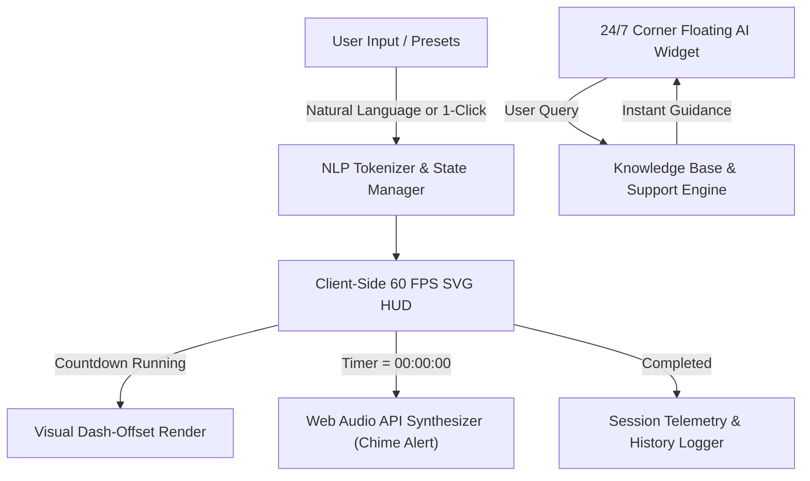

<div align="center">

# ⏱️ ChronoFlow-AI
### Modern Agentic Focus Orchestrator & 24/7 Live AI Assistant

[](https://chronoflow-ai.streamlit.app/)
[](https://www.python.org/)
[](https://streamlit.io/)
[](#)
[](LICENSE)

<br />

**[🌐 Launch Live Application](https://chronoflow-ai.streamlit.app/)** • **[✨ Key Features](#-key-features)** • **[⚙️ Technical Specs](#-technical-specifications)** • **[🚀 Quickstart](#-quickstart-guide)** • **[👤 Author](#-developer--portfolio)**

</div>

---

## 🌟 Overview

**ChronoFlow-AI** is a next-generation countdown timer and productivity focus orchestrator engineered with an **Agentic AI** design philosophy. 

Traditional Streamlit countdown timers suffer from server-side thread-blocking (`time.sleep(1)`), which freezes the UI, prevents pausing, and crashes upon user interaction. **ChronoFlow-AI** solves this fundamentally by decoupling temporal execution into a **zero-latency, client-side SVG circular engine**, complemented by a **24/7 floating corner AI Customer Support & Mission Assistant**.

> 💡 Built to be clean, intuitive, and accessible for everyone — from students and everyday users to high-performance software engineers.

---

## ✨ Key Features

### 1. ⏱️ 60 FPS Non-Blocking Circular HUD
- **Zero-Latency Execution:** Runs smoothly at 60 FPS using client-side SVG stroke-dashoffset animations.
- **Full Interactive Controls:** Instant **START**, **PAUSE**, **RESUME**, **RESET**, and quick time bump buttons (**+1m**, **+5m**, **+10m**) without any UI freezing or reload delay.

### 2. 💬 Floating Corner AI Assistant (24/7 Live Widget)
- **Website-Style Floating FAB:** Pinned permanently to the bottom-right corner of the screen with a glowing gradient and gentle pulse animation.
- **Embedded Knowledge Engine:** 100% offline, zero-quota dependency — answers queries in real-time about timer usage, Pomodoro science, and study routines in both **English and Urdu/Roman Urdu**.
- **1-Click Suggestion Chips:** Instant access to common questions.

### 3. 🤖 Natural Language Mission Dispatcher
- Simply write what you want in plain text:
  - `25m deep work on neural network`
  - `1h 30m code review`
  - `10 min chai break`
  - `45s eye relaxation`
- The built-in NLP tokenizer automatically extracts the duration and mission objective.

### 4. 🔊 Zero-Dependency Web Audio Synthesis
- **Harmonic Chimes:** Synthesizes pleasant musical chords (C5–E5–G5–C6) directly via the browser's **Web Audio API** when the timer completes.
- **No External Files:** Eliminates broken audio links or 404 missing asset errors.

### 5. 🎯 Tactical 1-Click Presets
- 💻 **Study / Work (25 min):** Pomodoro cognitive flow state.
- ☕ **Chai Break (5 min):** Short physical and mental reset.
- 🌴 **Rest (15 min):** Long recovery break.
- 🚀 **Deep Focus (45 min):** Extended architecture and exam preparation.

---

## ⚙️ Technical Specifications

| Parameter | Specification | Details |
| :--- | :--- | :--- |
| **Live URL** | [chronoflow-ai.streamlit.app](https://chronoflow-ai.streamlit.app/) | Hosted on Streamlit Community Cloud |
| **Backend Framework** | Python 3.12+ / Streamlit 1.42+ | Reactive state machine & session management |
| **Frontend HUD Engine** | HTML5 / Inline SVG / JavaScript (ES6) | Client-side event loop, 0ms latency |
| **Audio Architecture** | Web Audio API | Sine & triangle wave oscillator synthesis |
| **NLP Tokenizer** | Regex Semantic Parser | Extracts composite hours, minutes, and seconds |
| **Theme & Accessibility** | High-Contrast Slate Dark Mode | WCAG AAA contrast ratio (`#0b0f19` / `#ffffff`) |
| **Chatbot Architecture** | Floating Popover Widget | Bottom-right viewport-pinned modal |
| **State Persistence** | `st.session_state` | Tracks session streaks, total focus minutes & logs |

---

## 🏗️ Architecture & Workflow



---

## 🚀 Quickstart Guide

### 1. Clone the Repository
```bash
git clone https://github.com/SainBux-HadiSeelro/chronoflow-ai.git
cd chronoflow-ai
```

### 2. Install Dependencies
```bash
pip install -r requirements.txt
```

### 3. Run Locally
```bash
streamlit run app.py
```
Open your browser at `http://localhost:8501`.

---

## 📂 Project Structure

```
chronoflow-ai/
├── app.py              # Main Application (HUD, State Machine & Chatbot)
├── requirements.txt    # Production dependencies (streamlit>=1.42.0)
├── pyproject.toml      # Project packaging metadata
├── README.md           # Professional documentation
└── .gitignore          # Version control ignore rules
```

---

## 👤 Developer & Portfolio

Developed with passion by **Sain Bux (Hadi Seelro)** — *Agentic AI & Full-Stack Developer*.

- 🌐 **Live Demo:** [chronoflow-ai.streamlit.app](https://chronoflow-ai.streamlit.app/)
- 💻 **GitHub:** [@SainBux-HadiSeelro](https://github.com/SainBux-HadiSeelro)
- 💼 **Project Category:** Agentic AI Tools / Human-Computer Interaction / Productivity HUD

---

## 📄 License
This project is licensed under the **MIT License** — feel free to use, modify, and distribute.
